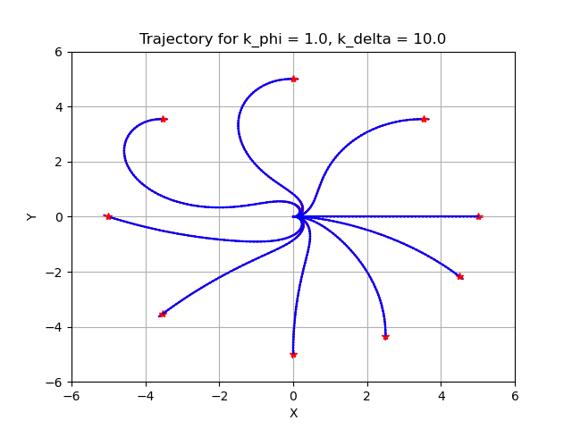

# Graceful Motion Controller
The graceful motion controller implements a controller based on the works of Jong Jin Park in "A Smooth Control Law for Graceful Motion of Differential Wheeled Mobile Robots in 2D Environment". In this implementation, a `motion_target` is set at a distance away from the robot that is exponentially stable to generate a smooth trajectory for the robot to follow.

See its [Configuration Guide Page](https://docs.nav2.org/rolling/configuration_and_development/configuration_guide/controller_plugins/configuring_graceful_motion_controller/) for additional parameter descriptions.

## Smooth control law
The smooth control law is a pose-following kinematic control law that generates a smooth and comfortable trajectory for the robot to follow. It is Lyapunov-based feedback control law made of three components:
* The egocentric polar coordinates of the motion target (r, phi, delta) with respect to the robot frame.
* A slow subsystem which describes the position of the robot.
* A fast subsystem which describes the steering angle of the robot.

## Motion target selection
On every control cycle, the controller looks for the motion target along the global plan:
* The first candidate is the point of the path at `max_lookahead`, interpolated if needed. Then it iterates backwards over the path poses towards the robot.
* For each candidate, the control law is forward simulated, checking for collisions. The simulation ends when the motion target is reached or when a step no longer gets closer to it. The candidate is only valid if the target is reached without collisions; otherwise it is discarded and a closer one is tried.
* If no candidate is valid before getting closer than `min_lookahead`, the controller fails with `NoValidControl`, which typically triggers replanning. This does not apply when the robot is approaching the goal.
* When the simulated velocity is above `footprint_scaling_linear_vel`, the footprint is scaled up for collision checking. If the trajectory collides, it is retried at lower velocities in steps of `footprint_scaling_step`.
* When approaching the goal with `prefer_final_rotation`, the orientation of the motion target is ignored. If the resulting trajectory gets closer than `obstacle_cost_margin` to the maximum valid cost, the controller searches for a safer approach angle in steps of `final_rotation_search_step`.
* Once the XY goal tolerance is reached, the robot rotates in place to the goal orientation, checking for collisions every `in_place_collision_resolution` radians.

## Parameters

| Parameter | Default | Description |
|-----|----|----|
| `max_lookahead` | 1.0 | The maximum lookahead distance (m) to use when selecting a target pose for the control law. Using poses that are further away will generally result in smoother operations, but simulating poses that are very far away can result in reduced performance, especially in tight or cluttered environments. |
| `min_lookahead` | 0.25 | The minimum lookahead distance (m) to use when selecting a target pose for the control law. This avoids instability when an unexpected obstacle appears in the path of the robot by returning failure, which typically triggers replanning. It is not applied when approaching the goal. |
| `k_phi` | 2.0 | Ratio of the rate of change in phi to the rate of change in r. Controls the convergence of the slow subsystem. If this value is equal to zero, the controller will behave as a pure waypoint follower. A high value offers extreme scenario of pose-following where theta is reduced much faster than r. **Note**: This variable is called k1 in earlier versions of the paper. |
| `k_delta` | 1.0 | Constant factor applied to the heading error feedback. Controls the convergence of the fast subsystem. The bigger the value, the robot converge faster to the reference heading. **Note**: This variable is called k2 in earlier versions of the paper. |
| `beta` | 0.4 | Constant factor applied to the path curvature. This value must be positive. Determines how fast the velocity drops when the curvature increases. |
| `lambda` | 2.0 | Constant factor applied to the path curvature. This value must be greater than 1. Determines the sharpness of the curve: higher lambda implies sharper curves. |
| `v_linear_min` | 0.1 | Minimum linear velocity. Units: meters/sec. |
| `v_linear_max` | 0.5 | Maximum linear velocity. Units: meters/sec. |
| `v_angular_max` | 1.0 | Maximum angular velocity produced by the control law. Units: radians/sec. |
| `v_angular_min_in_place` | 0.25 | Minimum angular velocity produced by the control law when rotating in place. This value should be based on the minimum rotation speed controllable by the robot. Units: radians/sec. |
| `slowdown_radius` | 1.5 | Radius around the goal pose in which the robot will start to slow down. Units: meters. |
| `deceleration_max` | 2.5 | Maximum deceleration used to compute a velocity limit based on distance to the goal: `v = sqrt(2 * dist * deceleration_max)`. Units: m/s². |
| `initial_rotation` | true | Enable a rotation in place to the goal before starting the path. The control law may generate large sweeping arcs to the goal pose, depending on the initial robot orientation and `k_phi`, `k_delta`. It cannot be enabled together with `allow_backward`. |
| `initial_rotation_tolerance` | 0.75 | The difference in the path orientation and the starting robot orientation to trigger a rotate in place, if `initial_rotation` is enabled. Units: radians. |
| `prefer_final_rotation` | true | The control law can generate large arcs when the goal orientation is not aligned with the path. If this is enabled, the orientation of the final pose will be ignored and the robot will follow the orientation of the path and will make a final rotation in place to the goal orientation. |
| `rotation_scaling_factor` | 0.5 | The scaling factor applied to the rotation in place velocity. |
| `allow_backward` | false | Whether to allow the robot to move backward. It cannot be enabled together with `initial_rotation`. |
| `in_place_collision_resolution` | 0.1 | When performing an in-place rotation after the XY goal tolerance has been met, this is the angle between poses to check for collision. Units: radians. |
| `use_collision_detection` | true | Whether to use collision detection to avoid obstacles. When disabled, no collision or cost checks are done, including the search for a safer approach angle. |
| `footprint_scaling_linear_vel` | 0.5 | The linear velocity threshold below which footprint scaling is not applied. Above it, the footprint is expanded proportionally to the ratio between the current velocity and `v_linear_max`. Units: meters/sec. |
| `footprint_scaling_factor` | 0.25 | The maximum additional scaling factor applied to the robot footprint at `v_linear_max`. A value of 0.25 means the footprint can be expanded up to 125% of its original size at maximum velocity. |
| `footprint_scaling_step` | 0.1 | The step size for reducing the simulated velocity when a trajectory is in collision at the current speed, from `v_linear_max` down to `footprint_scaling_linear_vel`. Units: meters/sec. |
| `obstacle_cost_margin` | 1 | The cost margin below the maximum valid cost that is considered close to obstacles. When the maximum cost along the final approach trajectory is within this margin, the controller searches for a safer approach angle. Must be less than the maximum non-obstacle cost. |
| `final_rotation_search_step` | 0.1 | The angular step size used when searching for an alternative final approach angle that avoids obstacles. Smaller values provide finer search granularity at the cost of increased computation. Units: radians. |

## Topics

| Topic  | Type | Description |
|-----|----|----|
| `local_plan`  | `nav_msgs/Path` | The trajectory simulated with the control law towards the current motion target. |
| `motion_target`  | `geometry_msgs/PoseStamped` | The current motion target used by the controller to compute the velocity commands. |
| `slowdown`  | `visualization_msgs/Marker` | A flat circle marker of radius `slowdown_radius` around the motion target. |
